# Omnia Game Suite

[Español](#español) · [English](#english) · [Capturas / Screenshots](#capturas--screenshots) · [Releases](https://github.com/wasav1/omnia-launcher/releases)

## Español

**Omnia Game Suite** reúne tus juegos y ports de Linux en una biblioteca local que puedes abrir desde Desktop, Big Mode o el panel rápido de Dux.

La distribución actual está dirigida a **Hyprland en Arch Linux y derivados de 64 bits**, como CachyOS. La compatibilidad con **KDE Plasma** y **GNOME** está prevista para versiones futuras. **Windows** está en evaluación.

### Instalar o actualizar

1. Descarga el instalador gráfico `Omnia-Game-Suite-<versión>-x86_64.run` o su versión `.AppImage` desde [GitHub Releases](https://github.com/wasav1/omnia-launcher/releases).
2. Dale permiso de ejecución y ábrelo desde tu sesión de Hyprland. El asistente comprueba el entorno y detecta una instalación de Omnia anterior.
3. En una instalación nueva, elige tus carpetas y, si usas Dux, la integración del panel. Puedes conectar tus cuentas de tiendas al terminar o más tarde desde Ajustes.
4. Si ya tienes Omnia, elige **Actualizar Omnia**, sigue el progreso y pulsa **Reiniciar ahora**. El asistente conserva tus carpetas, juegos, cuentas y preferencias.

Ambos instaladores incluyen los paquetes nativos de Arch y CachyOS para el núcleo, la app y la integración con Hyprland.

Cuando haya otra versión disponible, **Actualizar** aparece en Desktop, Big Mode y el panel de Dux. Puedes seguir usando Omnia mientras se prepara. Al elegir **Reiniciar ahora**, el sistema puede pedirte que autorices la instalación. Omnia reinicia su servicio y sus ventanas después de aplicarla.

### Qué puedes hacer

- **Biblioteca unificada.** Reúne ports de Omnia, juegos de Steam, Epic Games, GOG y Amazon Games y las instalaciones locales que detecta Omnia. Busca por nombre, filtra por origen o plataforma y vuelve a tus favoritos o juegos recientes.
- **Desktop.** Inicio reúne novedades, favoritos y juegos recientes. Explorar combina el catálogo de ports y las tiendas, con filtros, orden por año o nombre, y un acceso a la gestión de cuentas. Las fichas muestran descripción, fecha, géneros, desarrolladora, editora, requisitos y tamaño cuando la fuente los ofrece.
- **Juegos locales y arte.** Agrega ejecutables de Linux o Windows o escanea una carpeta para elegir qué importar. Puedes registrar ROMs propias y configurar un emulador compatible. En **Cambiar arte**, busca coincidencias por título, elige la edición y previsualiza portadas, fondos y logos. Omnia reutiliza el arte desde la caché local.
- **Instalación y descargas.** Instala ports y juegos compatibles, importa instalaciones existentes y administra o desinstala juegos desde su ficha cuando el origen lo permite. Steam gestiona sus propias transferencias. Desktop y Big Mode muestran la cola, la etapa, el progreso y las métricas disponibles, con un indicador mientras hay trabajos activos.
- **Partidas y estadísticas.** Consulta el tiempo jugado, la última sesión y el historial de actividad. Configura copias de seguridad para las partidas de juegos compatibles.
- **Big Mode.** Navega por Inicio, Biblioteca, Tienda, Descargas y Ajustes con mando, teclado o ratón. La Biblioteca ofrece estantería, cuadrícula y lista, con agrupación por consola. Incluye teclado virtual, ayudas con iconos según el mando, estado de batería cuando el dispositivo lo informa, prueba de controles, ajustes de audio y sonidos de interfaz. Puedes abrirlo desde el aviso de conexión de un mando, saltar su bienvenida animada y cerrarlo con confirmación desde Power.
- **Panel rápido de Dux.** Abre el panel desde el icono de Omnia en la barra. Busca en la biblioteca, lanza un juego, marca favoritos o abre su ficha y carpeta. Consulta el nombre y la batería del mando conectado y accede a Big Mode y Descargas.
- **Sistema e integraciones.** Big Mode ofrece un monitor del equipo y ajustes de audio. Omnia puede mostrar un HUD de rendimiento con MangoHud y compartir el juego activo mediante la presencia de Discord si la configuras.

La interfaz está disponible en español e inglés. El inicio de sesión depende de las herramientas de cada tienda. Omnia no solicita contraseñas de tiendas ni claves personales de SteamGridDB y no distribuye ROMs.

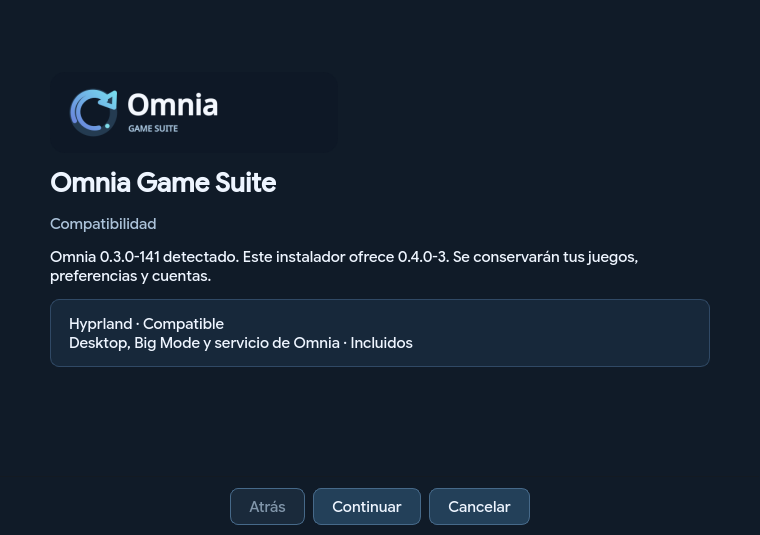

## English

**Omnia Game Suite** brings Linux games and ports into one local library accessible from Desktop, Big Mode, or the Dux quick panel.

The current release targets **Hyprland on 64-bit Arch Linux and Arch-based distributions** such as CachyOS. **KDE Plasma** and **GNOME** support is planned for future versions. **Windows** support is being evaluated.

### Install or update

1. Download the graphical `Omnia-Game-Suite-<version>-x86_64.run` installer or its `.AppImage` version from [GitHub Releases](https://github.com/wasav1/omnia-launcher/releases).
2. Make it executable and open it from your Hyprland session. The installer checks the environment and detects previous Omnia installations.
3. For a fresh install, choose your folders and enable quick panel integration if you use Dux. Connect store accounts at the end or later in Settings.
4. If Omnia is already installed, choose **Update Omnia**, follow the progress, and select **Restart now**. The wizard keeps your folders, games, accounts, and preferences.

Both installers include native Arch and CachyOS packages for the core service, the app, and Hyprland integration.

When a new version is available, **Update** appears in Desktop, Big Mode, and the Dux panel. Keep using Omnia while the update is prepared. Choose **Restart now** and authorize installation if prompted. Omnia restarts its service and windows after applying the update.

### What you can do

- **Unified library.** Bring together Omnia ports, games from Steam, Epic Games, GOG and Amazon Games, and detected local installations. Search by name, filter by source or platform, and return to favorites or recent games.
- **Desktop.** Home brings news, favorites, and recent games together. Explore combines the port catalog and stores, with filters, sorting by year or name, and access to account settings. Game pages show descriptions, release dates, genres, developers, publishers, requirements, and sizes when the source provides them.
- **Local games and artwork.** Add Linux or Windows executables or scan a folder to choose what to import. Register your own ROMs and configure a compatible emulator. In **Change artwork**, search by title, choose an edition, and preview covers, backgrounds, and logos. Omnia reuses artwork from its local cache.
- **Installation and downloads.** Install ports and supported games, import existing installations, and manage or uninstall games from their pages when supported by the source. Steam manages its own transfers. Desktop and Big Mode show the queue, stage, progress, and available metrics, with an indicator while jobs are active.
- **Saves and statistics.** Review playtime, the last session, and activity history. Set up save backups for supported games.
- **Big Mode.** Use a controller, keyboard, or mouse to navigate Home, Library, Store, Downloads, and Settings. The Library offers shelf, grid, and list views with grouping by console. Big Mode includes an on-screen keyboard, controller-specific button hints, battery status when reported by the device, input testing, audio settings, and interface sounds. Launch it from the controller connection prompt, skip the animated welcome, and confirm exit from the Power menu.
- **Dux quick panel.** Open Omnia from its icon in the bar. Search the library, launch a game, mark favorites, or open a game's page or folder. Check the connected controller's name and battery, or jump to Big Mode and Downloads.
- **System and integrations.** Big Mode includes system monitoring and audio settings. Omnia can display a MangoHud performance overlay and share the active game through Discord presence when configured.

The interface is available in English and Spanish. Sign-in depends on each store's tools. Omnia does not ask for store passwords or personal SteamGridDB keys and does not distribute ROMs.

## Capturas / Screenshots

### Panel rápido de Dux / Dux quick panel

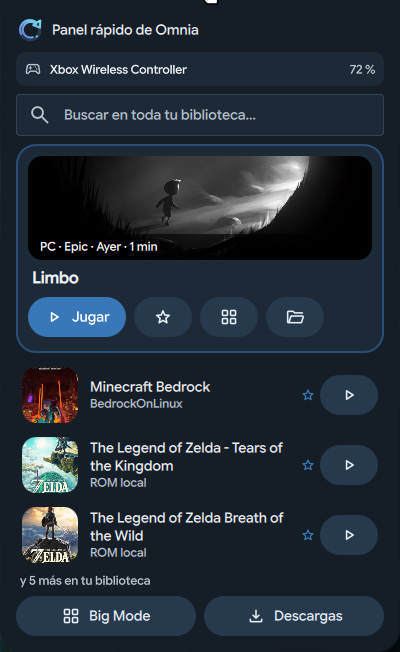

### Desktop

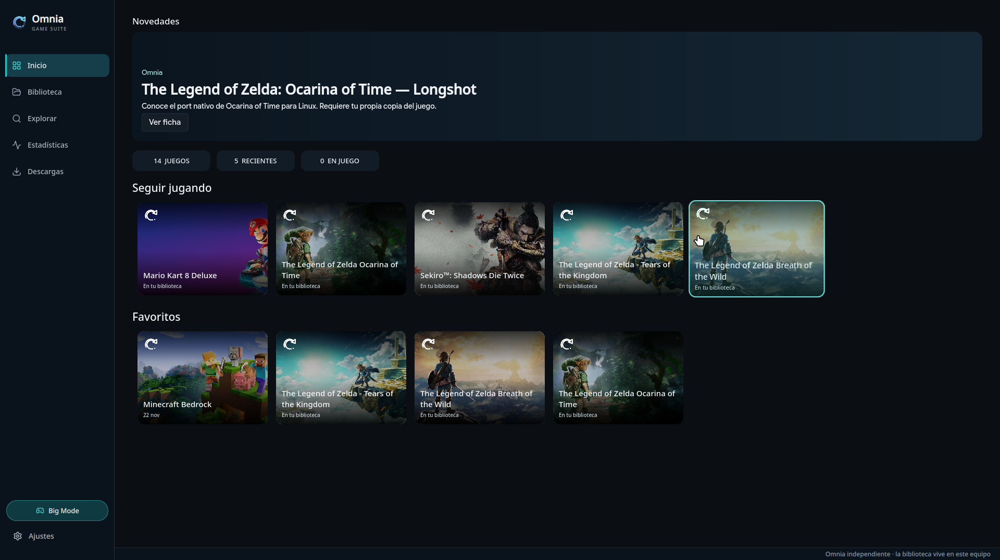

Biblioteca, Explorar y ficha de tienda / Library, Explore, and store details

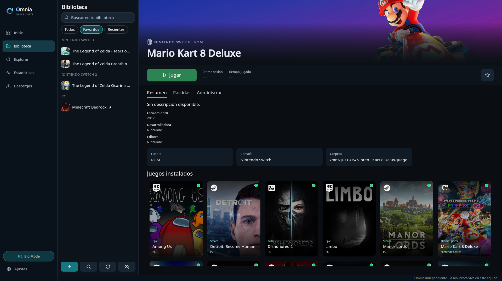

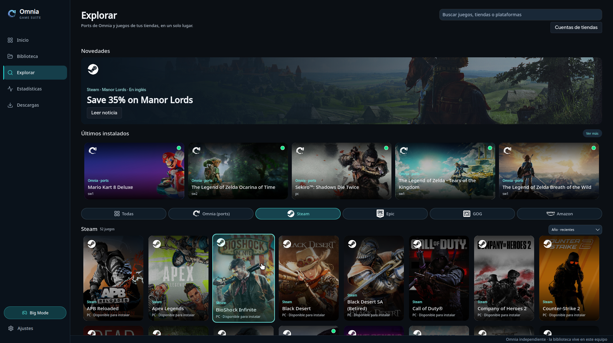

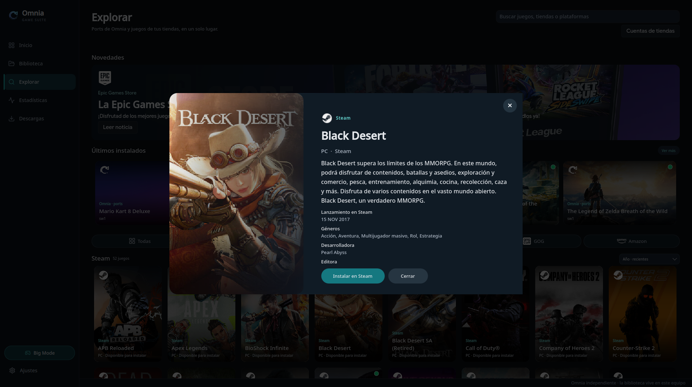

### Big Mode

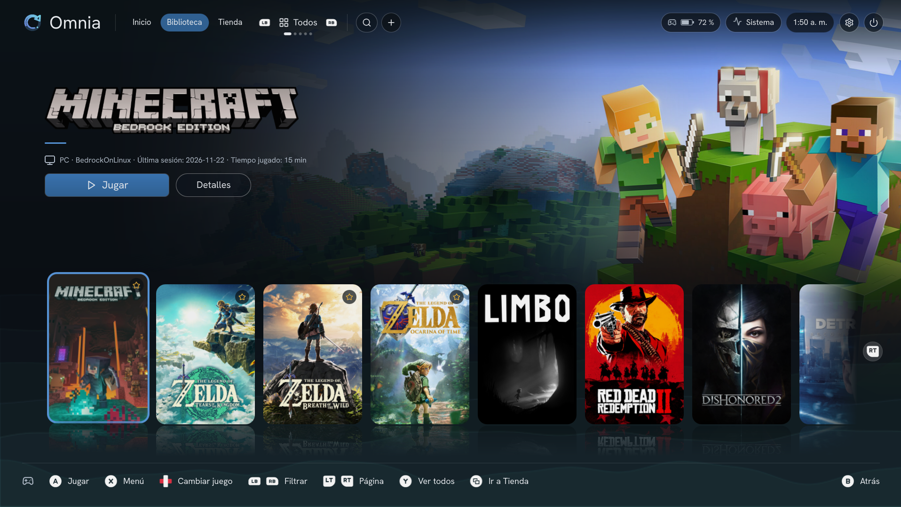

Bienvenida, Inicio, ficha, Tienda y vistas de Biblioteca / Welcome, Home, game details, Store, and Library views

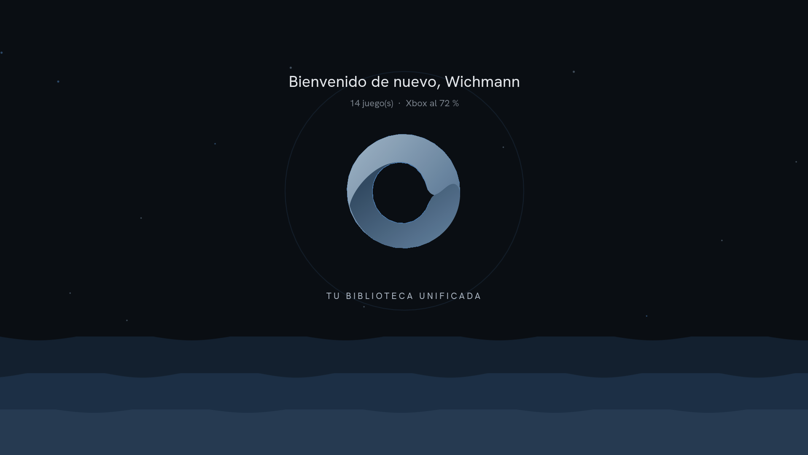

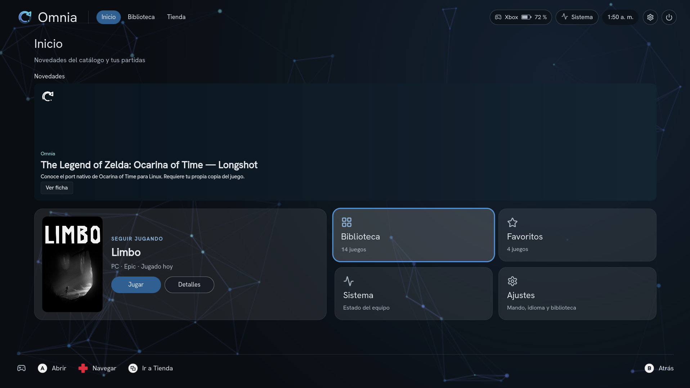

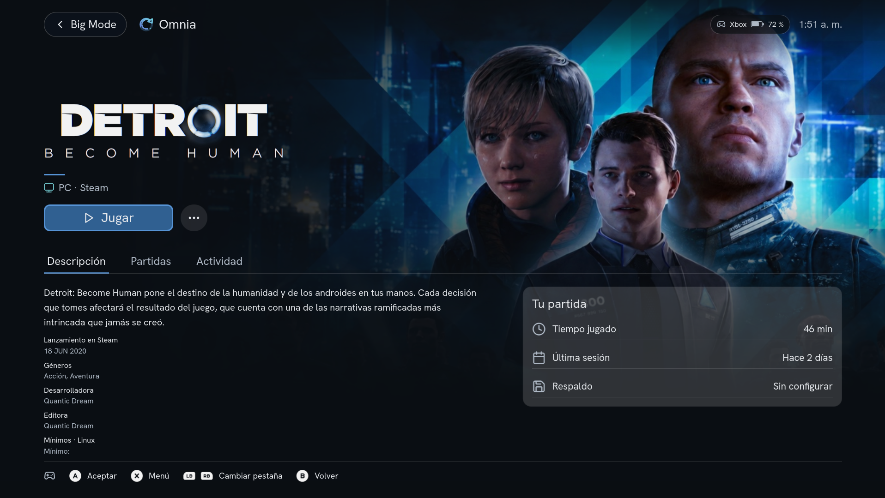

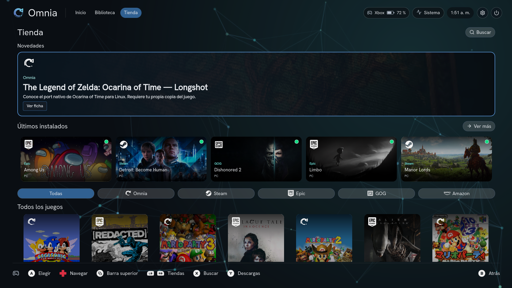

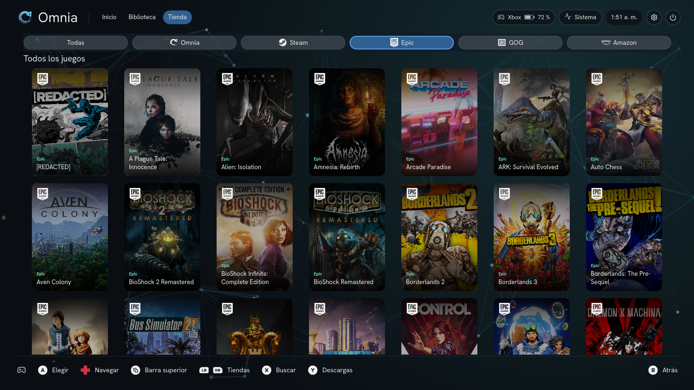

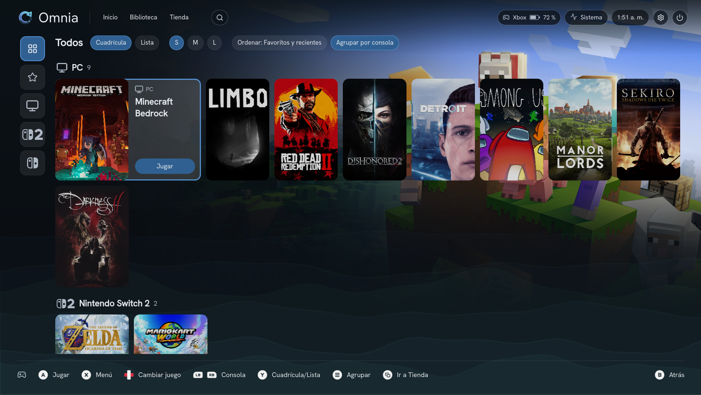

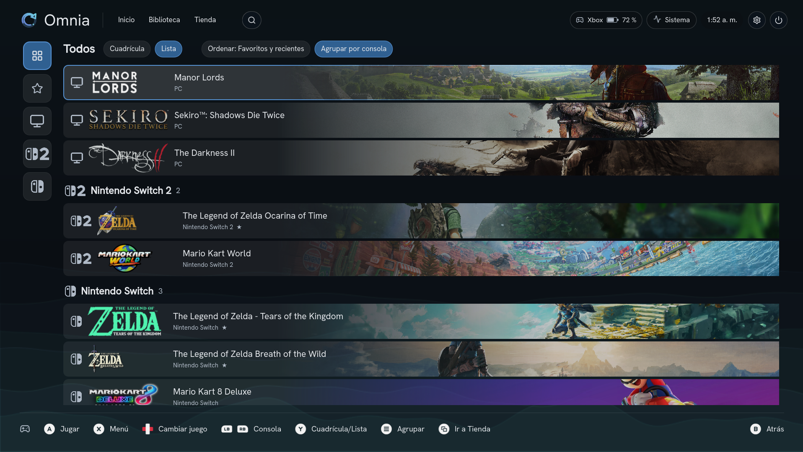

## Desarrollo / Development

El núcleo local usa Python y las interfaces usan Qt Quick (QML). El catálogo y la búsqueda de arte se sirven desde [Omnia Backend](https://github.com/wasav1/omnia-backend).

The local service uses Python and the user interfaces use Qt Quick (QML). [Omnia Backend](https://github.com/wasav1/omnia-backend) provides the public catalog and artwork search.

[Licencia / License · GPL-3.0-or-later](LICENSE).
